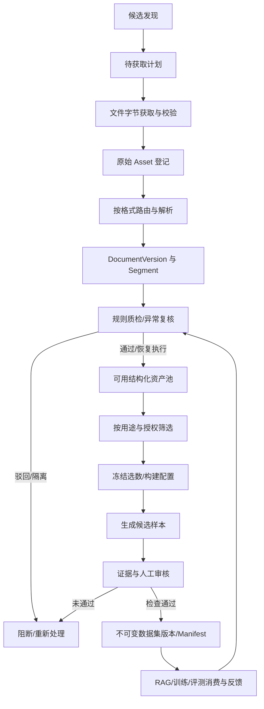

# CorpusFlow｜需求分析与确认（PRD + BRD + 验收基线）

> **文档编号** CF-REQ-001　**版本** 1.0　**日期** 2026-10-23　**状态** 待业务负责人评审确认  
> **基线** `CorpusFlow_V3_1.html`、`CorpusFlow_V3_1_CHANGELOG.md`、`CorpusFlow_V3_1_TEST_RESULTS.json`  
> **配套** `CorpusFlow_02_技术方案设计_V1.0.md`  
> **适用对象** 产品负责人、数据工程、后端、前端、测试、算法/数据质量、Codex 实施代理  
> **约束等级** **MUST** 必须实现；**SHOULD** 推荐实现；**MAY** 未来可选。

## 0. 如何使用本文件（发给 Codex 的执行规则）

1. 把本文件和《技术方案设计》放在仓库 `docs/specs/`；**先扫描项目实际代码/配置，再实施**，不得只根据原型页面推断已存在后端。
2. 以两份文档中的 `FR-*`、`BR-*`、`AC-*`、`NFR-*`、`TC-*` 作为开发和验证追踪 ID；任何变更必须写入对应的 ADR/变更记录。
3. **以当前 V3.1 原型作为 UI/流程参考，不把浏览器内存模拟行为当作真实能力**。API/DB/Worker 未连接时必须如实标注。
4. 先实现 P0 的一条端到端闭环，再扩展页面；每次提交附变更文件、接口差异、测试、迁移与回滚说明。
5. 遇到未确认业务口径，遵守本文件的保守默认规则（如用途授权**默认拒绝**），将待决策项登记到第 13 节，不得自行放宽权限或绕过质量门控。

## 1. 业务背景、目标与边界

### 1.1 产品定位

CorpusFlow 是**专业领域大模型数据工程管理平台**：将论文、标准、政策法规、专利、技术报告、漏洞公告等资料，经过**发现—获取—原始入库—解析/结构化—清洗与质检—筛选与构建—审核与发布—下游验证**，产出可审计、可追溯、可复现的数据产品。主要专业领域为密码分析、密码算法、后量子密码、零知识证明、多方安全计算、同态加密、隐私计算、区块链密码技术及商用密码标准与检测。

**不是**通用网盘、通用爬虫、纯 RAG 知识库，也不直接实现模型训练集群。RAG/训练/评测均属于数据产品的消费端。

### 1.2 V3.1 基线与真实实现的分界

V3.1 已模拟：10 个业务页面、资料筛选、来源/资产/文档/片段/样本关系、用途级许可门控、各模板 DAG、批量每资产一个 Run、审核/恢复、SFT/Pretrain/RAG/Eval 构建及版本快照、角色演示、查询驱动的规则检索。上一轮 Playwright 原型测试 **14/14 通过**，仅说明**页面模拟逻辑**通过；不代表后端、并发、安全、许可证合法性或真实模型效果通过。

**正式开发要新增**：真实鉴权、真实文件字节与哈希、持久化数据库、任务队列/Worker、对象存储、解析/清洗适配器、服务端校验、发布 Manifest 不变性、真正的审计和可观测性。当前基线所有演示数据均不能当作真实数据资产。

### 1.3 本期范围

| 等级 | 内容 | 产出界限 |
|---|---|---|
| P0 / MVP | IAM/工作空间、授权台账、真实上传、资产查询、PDF/HTML 处理、结构化片段、质量复核、任务恢复、数据集选数、SFT 生成候选、发布不可变版本、血缘查询 | **真实** E2E 处理至少一种 PDF 和 HTML；任何缺外部模型的生成必须明确处于 mock/test 模式 |
| P1 | URL/DOI 实际采集、异构数据源、Data-Juicer 适配、预训练/RAG/评测构建、真实索引/评测、数据覆盖与配比分析、下载导出、运营仪表盘 | 按每条单独验收，未经接入不得标记完成 |
| P2 | 专利/扫描件/公式表格高保真、多租户大规模调度、分布式高可用、智能采集 Agent、DPO 偏好对、数据质量闭环智能优化 | 仅作为路线图，不阻断 P0 |

### 1.4 本期不做

不自行重写 OCR/VLM 预训练、不保证网络资料天然有训练版权、不自动绕过网站服务条款、不在数据工程平台中实现模型训练框架、不把 LLM 评分视为人工复核、不允许从 UI 直接绕开权限调用外部执行器。

## 2. 用户、职责与权限模型

| 角色 | 查看有权访问的数据 | 接入/资产编辑 | 流水线执行/构建 | 质量/候选审核 | 发布 | 系统配置 |
|---|---:|---:|---:|---:|---:|---:|
| 只读用户 | ✓ | — | — | — | — | — |
| 数据工程师 | ✓ | ✓ | ✓ | — | — | — |
| 数据审核员 | ✓ | — | — | ✓ | — | — |
| 发布管理员 | ✓ | — | — | — | ✓ | — |
| 管理员 | ✓ | ✓ | ✓ | ✓ | ✓* | ✓ |

`*` 管理员仍必须通过**同一构建的审核人和发布人不能为同一 user_id** 的职责分离检查；可有独立审核/发布者。用户可拥有多角色，但操作按实际 user_id 校验，不以切换显示角色规避。

权限必须由服务端 **RBAC + 工作空间/数据范围 ABAC** 共同决定：包含 `workspace_id`、资产可见性/敏感等级、来源授权及操作动作。所有列表查询、单对象查询、导出、任务恢复均要检查对象级授权。前端隐藏按钮只是体验，不构成安全边界。

## 3. 业务对象定义和统计口径

| 对象 | 定义 | ID / 生命周期 | 是否计入“原始文件总数” |
|---|---|---|---|
| DiscoveryCandidate | 发现但未获取、未校验的候选线索/URL/DOI | `candidate_id` | 否 |
| IngestPlan | 已确认待获取的资料计划及候选集合 | `ingest_plan_id` | 否 |
| Source | 来源系统/机构/站点及来源许可证明 | `source_id`（与单份资产不混用） | 否 |
| Asset | **成功保存文件字节、计算哈希并完成登记**的不可变原始文件实体 | `asset_id` | **是**；同文件重复登记引用须按“唯一资产”去重 |
| Document | 从 Asset 解析得到的逻辑文档 | `document_id` | 否 |
| DocumentVersion | 不可变解析/修订版本（结构、页码、规则、产物） | `document_version_id` | 否 |
| Segment | 属于特定 DocumentVersion 的章节/段落/表格/公式片段 | `segment_id` | 否 |
| PipelineRun / NodeRun | 一个资产一次执行及节点执行记录 | `run_id` / `node_run_id` | 否 |
| QualityIssue / Review | 质量异常与人工决策事件 | `issue_id` / `review_id` | 否 |
| DatasetBuild | 对选数与配置进行版本锁定的构建任务 | `build_id` | 否 |
| CandidateSample | 构建生成、尚待复核的候选样本 | `sample_id` | 否 |
| DatasetVersion | 经门控通过发布的不可变数据集版本 | `dataset_version_id` | 否 |

**计量单位**：资产数=份；存储=实际字节 GB/TB；文档=个；片段=条；样本=条；Token=指定 tokenizer 的计数结果；任务=次；产物=个；版本=个。**文件→片段→样本不能直接采用同一数量做“转化率”**，只展示各自口径与父子数量分布。领域为多标签，标签计数相加可大于去重资产总数。

资产统计必须有 `as_of`、筛选范围、去重规则、计数基表；演示快照必须显式 `snapshot/demo` 标识，不与真实实时 KPI 混排。软删除应保留可审计引用，默认统计排除 `deleted_at IS NOT NULL` 资产。

## 4. 端到端业务流

任何状态转换都必须有操作者/执行器、时间、原因、输入版本、结果和事件日志；失败不能默默吞掉，审核通过不等于 Worker 执行成功。

## 5. 功能需求清单（带标识、优先级、验收点）

### 5.1 页面与导航

| FR 编号 | 页面 / 功能 | 必要能力（MUST） | 优先级 | 验收引用 |
|---|---|---|---|---|
| FR-001 | 总览工作台 | 分资产类型/格式/领域、数据阶段、任务状态、质量异常、最近发布；可点跳转并传递过滤条件 | P1 | AC-DASH |
| FR-002 | 数据接入中心 | 真实多文件上传、批次、URL/DOI 计划与候选区别、错误详情和重试 | P0 上传，P1 采集 | AC-ING |
| FR-003 | 原始数据资产 | 组合筛选、权限过滤、分页排序、资产详情、批选、元数据导出 | P0 | AC-ASSET |
| FR-004 | 结构化数据资产 | 文档→版本→章节→片段，PDF/Markdown/JSON 对照、领域与质量标签、按用途筛选 | P0 | AC-STRUCT |
| FR-005 | 数据处理中心 | DAG 模板、算子库、参数版本、任务批次/独立 Run、日志、重试/恢复 | P0 | AC-RUN |
| FR-006 | 质量与审核中心 | 规则集、指标口径、异常、证据、审查记录、质量门控 | P0 | AC-QA |
| FR-007 | 数据血缘追踪 | Source→Asset→DocumentVersion→Segment→Sample→DatasetVersion 双向查询 | P0 | AC-LINEAGE |
| FR-008 | 数据产品中心 | SFT/Pretrain/RAG/Eval/DPO 分类、六步构建、预览、审核、数据集版本 | P0 SFT，P1 其他 | AC-BUILD |
| FR-009 | 下游效果验证 | query→检索→授权过滤→引用→反馈，零证据拒答 | P1 | AC-RAG |
| FR-010 | 系统管理 | 登录、工作空间、角色/成员、集成配置状态、操作审计 | P0 IAM，P1 集成 UI | AC-IAM |

### 5.2 数据接入与资产

| FR 编号 | 功能与规则 | P |
|---|---|---|
| FR-011 | 浏览器预选文件只进入客户端“已选择”；服务端 `upload/init → chunk/put → complete → verify → register` 才能生成 Asset | P0 |
| FR-012 | 批次有唯一 `batch_id`、输入清单、每文件状态、失败原因、成功/失败/跳过/重复数量，文件间失败隔离 | P0 |
| FR-013 | 文件 MIME/扩展名交叉校验、大小上限配置、SHA-256、病毒扫描/危险格式阻断；不得信任用户文件名作为存储路径 | P0 |
| FR-014 | URL/DOI 发现只能创建 Candidate/Plan，获取实际文件成功后才建 Asset；服务端做 SSRF/域名/重定向/下载大小限制 | P1 |
| FR-015 | Source、业务资料类型、技术格式、专业领域(多标签)、作者/年份/DOI/编号、语种、授权独立保存 | P0 |
| FR-016 | 多条件 AND 组合、同字段多值 OR，分页总数与列表一致；筛选、排序、导出尊重空间和授权权限 | P0 |
| FR-017 | 批选 N 个资产必须生成可追溯 ProcessingBatch 和**恰好 N 条独立 Run（若有阻断则逐资产列拒绝原因）**，不得只取第一条 | P0 |

### 5.3 流水线、结构化和质量

| FR 编号 | 功能与规则 | P |
|---|---|---|
| FR-018 | PDF/HTML/专利/结构化清洗/SFT 候选模板各有独立 DAG 与输入输出 schema；本期 P0 至少支持 PDF、HTML | P0/P1 |
| FR-019 | 版本化 DAG 校验无环、入口出口及类型兼容；节点参数 JSON Schema 校验，保存新 revision，不原地篡改正在运行的任务参数 | P0 |
| FR-020 | 任务运行保存 template_version + config_snapshot + input_asset_checksum、node_run/attempt、日志 URI、指标、产物 ID | P0 |
| FR-021 | 节点失败可按策略 retry/backoff/jitter；幂等重试不重复发布产物；人工审核等待态不占 Worker | P0 |
| FR-022 | 解析生成 DocumentVersion、Section/Segment、页码/版面定位、原文/处理前后对比，所有产物保留源文件与算子版本血缘 | P0 |
| FR-023 | 质量报告至少覆盖完整性、乱码/HTML 噪声、重复度、领域匹配、证据覆盖、来源/许可，规则版本可回放 | P0 基础项 |
| FR-024 | 审核可通过待重跑、驳回、退回、隔离；**驳回/隔离/待审核均不能恢复，也不能构建或发布** | P0 |
| FR-025 | 复核结论不直接改产物为成功；通过后要显式 resume，Worker 重新执行后才写新产物并关闭异常 | P0 |
| FR-026 | 质量评分/覆盖率必须记录计算范围、方法、阈值、样本量、指标版本、时间；自动分数与人工结论分开展示 | P1 |

### 5.4 用途授权、数据产品与发布

| FR 编号 | 功能与规则 | P |
|---|---|---|
| FR-027 | 授权用途至少 `research / training / rag / evaluation / redistribute`；**用途之间无隐式继承**，各用途独立检查证据和有效期 | P0 |
| FR-028 | 训练授权 `training` 适用 SFT、Pretrain；RAG 用 `rag`；独立 Eval 用 `evaluation`；外部分发再要求 `redistribute` | P0 |
| FR-029 | 六步向导：选产品→选来源→排除预览→配置策略→生成并审核候选→校验发布 | P0 SFT |
| FR-030 | 预览显示命中资产/文档/片段、Token 估算、领域/类型/来源分布、排除原因与数量、许可/质量候选比例 | P0 |
| FR-031 | Build 创建时冻结 `config_hash`、输入 `document_version_id + segment_id + content_hash`、策略/模型版本、候选 ID | P0 |
| FR-032 | 变更选数/来源/质量条件/策略/划分时旧候选失效，必须重新构建与审核；仅独立的目标发布版本号可改，仍需唯一性检查 | P0 |
| FR-033 | SFT 样本有 messages、evidence_ids、source_id、model/prompt 版本、质量和审核；缺证据或 unsupported claim 不能发布 | P0 |
| FR-034 | 训练/验证/测试按**来源组**固定划分，防训练/评测近重复泄漏；分组不足时阻断并解释，目标比例与实际计数分别显示 | P0 |
| FR-035 | 发布门控检查：用途授权、质量 issue、候选审核、schema、血缘、分组泄漏、配置快照、权限与职责分离；不可绕过 | P0 |
| FR-036 | DatasetVersion + Manifest + 文件内容哈希 + 质量报告 + 入选样本清单在**同一事务语义**下提交，版本内容不能修改 | P0 |
| FR-037 | Pretrain 输出 `text` + source 与 Token；RAG 输出 chunk/page/metadata；Eval 输出 question/reference_answer/evidence/difficulty；DPO 单独设计 chosen/rejected | P1/P2 |
| FR-038 | 版本导出 JSONL/Parquet（按产品和许可过滤），生成校验和与下载审计；未完成不得显示“已交付” | P1 |

### 5.5 验证、权限和可观测

| FR 编号 | 功能与规则 | P |
|---|---|---|
| FR-039 | RAG 检索在授权过滤后的片段上执行，query/hits/ranking/index_version 构成不可混用快照，query 变更必须重新检索 | P1 |
| FR-040 | 无匹配、全部被权限过滤或引用证据不足时明确拒答；反馈关联 query_id/hit_id/segment_id，并可建 QualityIssue | P1 |
| FR-041 | 所有写操作授权由后端校验，重要动作记不可篡改审计事件，用户/空间/对象/请求 ID 可关联 | P0 |
| FR-042 | 任务支持轮询（P0）及可选 SSE（P1），日志不得泄露 Token、私钥、原始敏感正文 | P0 |
| FR-043 | 统计支持 as_of、metric_definition_version；外部展示可显示“真实测量/估算/演示”的指标来源 | P0 |

## 6. 业务规则（实施时优先级高于 UI 表现）

### 6.1 授权矩阵（BR-AUTH）

**BR-AUTH-01 默认拒绝**：没有 grant、未确认、已过期、被撤销、来源不清或缺证据 → `DENY`；不得把“内部研究/内部检索/开源可阅读/可访问/已入库/质量通过”等同于训练许可。

| 许可示例 | research | training(SFT/Pretrain) | rag | evaluation | redistribute |
|---|---:|---:|---:|---:|---:|
| 仅内部研究，许可已核实 | ✓ | ✗ | ✗ | ✗ | ✗ |
| 仅允许内部 RAG，许可已核实 | 按 grant | ✗ | ✓ | ✗ | ✗ |
| 仅训练授权，许可已核实 | 按 grant | ✓ | ✗ | ✗ | ✗ |
| 训练+评测，许可已核实 | 按 grant | ✓ | ✗ | ✓ | ✗ |
| 待核实 / 证据缺失 / 已撤销 | ✗ | ✗ | ✗ | ✗ | ✗ |

**BR-AUTH-02** 权限以 `asset_id + purpose + workspace_id + effective_at` 求值，必要时结合 Source 上游条款与细粒度例外；如上下游冲突，采取更严格规则，记录 `policy_version + evidence_ids + decision_reasons`。  
**BR-AUTH-03** 生成候选和发布/导出时都要重检，索引/缓存必须随撤销授权失效或隔离。  
**BR-AUTH-04** SFT、Pretrain 必须检查 training；RAG 检查 rag；Eval 检查 evaluation；对外提供下载/第三方发布另检 redistribute 和其它适用限制。  
**BR-AUTH-05** QA 的人工“审核通过”只代表质量审查，不授予版权许可证。自动归类结果不能签发授权。  

### 6.2 处理、审核与重试（BR-RUN）

- **BR-RUN-01** Task `queued → running → succeeded`；异常 `running → failed / awaiting_review / cancelled`；恢复只允许合规 `failed|awaiting_review` 经复核变 `ready_to_resume → queued`；Worker 真正完成后才标成功。**不允许** `rejected → running` 直跳。
- **BR-RUN-02** QualityIssue 状态 `open → in_review → approved_for_rework|rejected|returned|isolated → resolved`。`approved_for_rework` 非 `resolved`，只有重跑产物和新质检通过可关闭。
- **BR-RUN-03** 对单 Asset 的节点写入必须幂等：`run_id + node_id + attempt_no` 唯一，成功产物 content_hash 可检测重复；重复 HTTP 请求不得产生重复 Run。
- **BR-RUN-04** 每个 Batch 必须记录每个 Asset 处理结果；允许部分成功，不能用批次总成功掩盖失败资产。
- **BR-RUN-05** 参数、环境镜像摘要、算子版本、输入 Asset SHA-256、输出 Artifact SHA-256 全部可查询，便于重现。

### 6.3 构建、审核与版本（BR-BUILD）

- **BR-BUILD-01** 构建快照包含筛选配置、输入片段及其版本/哈希、生成策略/Prompt/模型版本、样本、审核事件、质量结果、分组划分和 Manifest 生成元信息；任何实际内容变更必须重新审核。
- **BR-BUILD-02** 候选生成/审核/发布是三个权限动作；发布人不得等于任一审核人的 `user_id`，若采用多人复核，以明确审批策略判定。
- **BR-BUILD-03** 发布使用 `build_id + expected_build_revision + publish_request_id` 做并发控制/幂等。已发布 DatasetVersion 及内容哈希不可修改；整改只能发布新版本或撤回旧版本可见性。
- **BR-BUILD-04** 不合格候选可从发布集中剔除，但应更新**最终样本清单/分组/验证结果**并冻结为新的 release candidate；不允许旧检查结果复用为新集合的通过证明。
- **BR-BUILD-05** 完整性与元数据覆盖率使用明确分母；不能把同一来源组放入 train 与 val/test，质量评测集应进一步做近重复检测。

### 6.4 血缘、审计与删除（BR-GOV）

- **BR-GOV-01** 从任一 Sample 必须找到 Segment → DocumentVersion → Document → Asset → Source；从 Source 能追出全部关联 DatasetVersion。每条 lineage edge 保留关系类型和创建事件。
- **BR-GOV-02** 所有资产、片段与版本查询先做租户/空间、身份和用途授权；禁止只凭全局 ID 查询其它工作空间数据。
- **BR-GOV-03** 删除遵循软删除/保留期/法务保全；如来源撤权，阻断新消费与导出，保留追溯记录并触发受影响版本处置流程。
- **BR-GOV-04** 审计记载 `actor_id, workspace_id, action, resource_type/id, before/after summary, correlation_id, timestamp`，不得把机密全文直接写审计。

## 7. 质量指标、数据覆盖率及验收阈值

以下是**建议的 P0 初始门控阈值**，须由业务方在首轮真实语料抽样后调参，不得冒称行业统一标准。

| 指标/单位 | 计算方式 | P0 建议门控/展示 | 数据源 |
|---|---|---|---|
| 解析成功率 | succeeded asset / attempted asset | 展示；上线目标 ≥95%（分格式统计，验收样本集另设预期） | Run / Asset |
| 结构化完整率 | 必填字段非空片段 / 有效片段 | 发布候选的必要字段 **100%**；其他字段只展示 | Segment schema |
| 样本血缘覆盖率 | 能回溯 Source+Asset+DV 的发布样本 / 发布样本 | **100% 阻断门控** | Lineage |
| 许可证覆盖率 | 具有该用途有效 grant 的入选样本 / 入选样本 | **100% 阻断门控** | Grant + Sample |
| 证据覆盖率（SFT/Eval） | 证据关联有效的样本 / 发布样本 | **100% 阻断门控**；事实正确性还需抽审 | Evidence Ledger |
| 有阻断性质量 Issue 的入选样本 | COUNT | **0** | QualityIssue |
| 数据重复率 | 近重复/精确重复数 / 被检样本数 | 展示；上线前明确算法及阈值后纳入门控 | Dedup Record |
| 领域覆盖率 | 目标领域中已有可用合规数据的领域数 / 目标领域数 | 展示及缺口，不强制一刀切 | Taxonomy + Segment |
| 来源配比 | 每种来源的入选样本数、Token 与源组数 | 展示目标与实际，强制来源隔离 | DatasetBuild |
| Token 数 | 对冻结文本以指定 tokenizer 版本计数 | 发布时冻结计数版本；禁止与估算混淆 | Tokenizer |

**NFR 目标（初始工程预算，验收前需压测校正）**：

- **NFR-01 安全**：HTTPS、服务端鉴权与空间隔离、默认拒绝许可、最小权限、密钥不入库明文/不入日志、下载授权检查；必须。
- **NFR-02 API 性能**：10 万资产索引量时 `GET assets` P95 ≤ 800ms（每页 50、常用索引、非全文深检索）；待压测确认。
- **NFR-03 异步响应**：创建处理批次请求 P95 ≤ 2s（只入队不等待解析）；实际 Worker 完成时间依文件大小报告。
- **NFR-04 正确性**：幂等重复请求不重复创建资产/版本/Run；单批 N 项逐项结果一致。
- **NFR-05 恢复**：Worker 重启后能从持久化 NodeRun/Job 恢复；不得仅凭浏览器缓存维持状态。
- **NFR-06 可观测**：请求/任务/节点/生成/发布跨系统可通过 `request_id/run_id/build_id` 关联。
- **NFR-07 兼容**：主流桌面 Chromium / Safari / Firefox 最近版本；移动端无严重布局溢出；接口向后兼容。
- **NFR-08 质量**：P0 核心领域服务分支测试覆盖率建议 ≥80%，授权/发布/状态机分支覆盖率 100%（以关键决策覆盖衡量，不只看行覆盖）。

## 8. 关键用户故事与验收标准（Given / When / Then）

### AC-ING / AC-ASSET：接入与资产

- **AC-ING-01** Given 本地选择 3 个文件，When 只完成浏览器选择，Then Asset 数为 0 增量，UI 显示 `selected` 而非 `uploaded`。
- **AC-ING-02** Given 文件上传字节、哈希、扫描、登记全部成功，When Complete 成功，Then 生成 Asset ID、SHA-256、对象存储 URI、BatchItem 与审计事件。
- **AC-ING-03** Given 第 2 个文件损坏，When 批量完成，Then 第 1、3 项成功、第 2 项失败且有失败原因，数量之和等于 3。
- **AC-ING-04** Given 用户保存 URL/DOI 候选，When 未真实下载，Then Candidate/Plan 增加而 Asset 总数与容量不变。
- **AC-ASSET-01** Given 域=密码分析、格式=PDF、质量=reviewed 的筛选，When 查询列表和统计，Then ID 集及 count 使用相同的过滤条件、排序稳定、翻页无重复。
- **AC-ASSET-02** Given A 用户无 B 工作空间权限，When 通过猜测 asset_id 查询/导出，Then 403/404 受保护响应，不泄露其它资产信息。

### AC-RUN / AC-STRUCT：执行和结构化

- **AC-RUN-01** Given 批量选中 N=3，When 创建批次，Then 返回同批次下 3 个不同 Run ID，每条都指向对应 Asset ID。
- **AC-RUN-02** Given 同一 `Idempotency-Key` 重试提交，When 请求体相同，Then 返回同一 batch/run 集合；请求体不同则报冲突。
- **AC-RUN-03** Given PDF 与 HTML，When 创建 Run，Then 默认路由到各自有效 DAG，节点的 input/output schema 和参数快照符合模板版本。
- **AC-RUN-04** Given 算子失败并生成 issue，When 未审批/已驳回/隔离时 Resume，Then 返回 `RUN_REVIEW_BLOCKED` 且不产生新 Artifact。
- **AC-RUN-05** Given issue 审核通过待重跑，When 审核动作完成，Then任务仍未成功；**只有** resume + Worker 真正完成 + 重质检通过，才生成新的 DV/Segment 并关闭 issue。
- **AC-STRUCT-01** Given 处理完成的 PDF，When 查某 Segment，Then 能展示关联 DV、页码、源文件哈希、解析算子与 JSON/Markdown 片段。
- **AC-STRUCT-02** Given Segment 来源仅允许 research，When 过滤“可用于 SFT”，Then 该片段不出现，或只以排除项显示且理由为 training grant 缺失。

### AC-QA / AC-IAM：审核与权限

- **AC-QA-01** Given 解析输出表格字段缺失，When 自动质量检查，Then创建带 rule_version、证据位置、状态的 Issue，不会自动变成发布合格。
- **AC-QA-02** Given 审核员驳回某 Issue，When 工程师尝试恢复/发布，Then均受阻断，操作写入审计。
- **AC-QA-03** Given 审核员批准重处理，When 尚无成功的新产物，Then issue 为 `approved_for_rework` 而不是 `resolved`。
- **AC-IAM-01** Given 工程师，When POST 发布端点，即使绕开 UI，Then 403；审核员调用构建端点也是 403。
- **AC-IAM-02** Given 同一 user_id 同时有审核与发布角色，When 审核自己构建的候选后试图发布，Then `SELF_APPROVAL_FORBIDDEN`；管理员也不豁免。

### AC-BUILD：选数、构建、发布

- **AC-BUILD-01** Given 一份仅 `research`、一份仅 `rag`、一份仅 `evaluation`、一份仅 `training` 的已审核资料，When分别创建 SFT/Pretrain/RAG/Eval，Then仅获得目的许可的来源入选，各排除理由可查。
- **AC-BUILD-02** Given SFT 六步向导，When选择密码分析 / 全来源 / `reviewed`，Then同时显示命中、排除总数及每条原因，预览的输入列表可以冻结为 Build。
- **AC-BUILD-03** Given 已生成候选的 Build，When修改领域、源、质量、策略、所选片段或源文档版本，Then旧构建不能发布，须重新生成并审核。
- **AC-BUILD-04** Given候选未审核/证据缺失/Schema 错误/源质量问题未闭环，When发布，Then返回逐项门控失败明细，不产生 DatasetVersion。
- **AC-BUILD-05** Given三份独立 Source Group，When配置 80/10/10，Then可按确定性算法完成三组不同划分并显示实际组计数；不足三组时必须阻断而不是混用同源。
- **AC-BUILD-06** Given所有门控通过且发布人与审核人不同，When同一 Idempotency-Key 连续调用两次发布，Then只存在一个 DatasetVersion，Manifest 与发布样本清单/配置/Hash 一致。
- **AC-BUILD-07** Given已发布 v1.0.0，When修改原候选或新增片段，Then历史版本样本、Manifest 和内容哈希不变；想更新必须生成新版本。

### AC-LINEAGE / AC-RAG / AC-DASH

- **AC-LINEAGE-01** Given已发布 SFT 样本，When从 Sample ID 反向查询，Then按关联 ID 可回溯 Segment→DV→Asset→Source、Run、NodeRun 与审核事件，缺任一环节不得发布。
- **AC-RAG-01** Given与语料无关的天气问题，When检索，Then hits=0，回答说明无支持证据，不显示虚构引用。
- **AC-RAG-02** Given已成功检索问题 Q1，When改为 Q2 但未重新检索，Then清空/失效 Q1 命中和回答；引用均绑定对应 query_id。
- **AC-RAG-03** Given检索命中来自被撤权资产，When再次查询/展示结果，Then该资产从可见结果中消失或被拒绝引用。
- **AC-DASH-01** Given录入 2 候选 URL 和 1 待获取计划，When刷新总览，Then原始 Asset 数保持不变；显示候选、计划各自的数量和统计来源。

## 9. 验收测试矩阵与测试数据

**固定测试夹具（仅测试环境生成，许可均为模拟）**：

| Fixture | 类型 | quality | grants | 特殊用途 |
|---|---|---|---|---|
| FX-01 | PDF 密码分析 | reviewed | research + training | 成功 SFT/Pretrain |
| FX-02 | PDF 标准 | pending | research | 表格异常，驳回恢复禁止 |
| FX-03 | HTML 漏洞公告 | reviewed | rag | 仅 RAG，不能训练 |
| FX-04 | PDF 论文 | reviewed | evaluation | 仅 Eval |
| FX-05 | 专利 | reviewed | none/unverified | 未授权，始终排除 |
| FX-06 | PDF 论文（与 FX-01 同源组） | reviewed | training | 检测跨 split 泄漏 |
| FX-07 | PDF 论文（独立源组） | reviewed | training | 正常来源分组 |
| FX-08 | PDF 论文（独立源组） | reviewed | training | 正常来源分组 |

**必跑测试集合**：TC-01 文件选中与上传分离；TC-02 三文件部分失败；TC-03 URL 候选不增加资产；TC-04 搜索与统计一致；TC-05 权限对象越权；TC-06 research 不等于 training；TC-07 各用途独立授权；TC-08 撤销授权后再校验；TC-09 N=3 批量 N Run；TC-10 同 key 幂等；TC-11 失败/驳回阻断恢复；TC-12 审核通过仍需执行；TC-13 Worker 重启恢复；TC-14 不同模板 DAG；TC-15 源文件/版本/片段血缘；TC-16 变更构建配置失效；TC-17 证据缺失不可发布；TC-18 来源分组泄漏；TC-19 自审自发禁止；TC-20 并发只发布一个版本；TC-21 已发布内容不可修改；TC-22 零命中 RAG 拒答；TC-23 query 快照失效；TC-24 跨空间检索隔离；TC-25 API 验证/错误码契约；TC-26 数据迁移与回滚；TC-27 UI 与真实 API 合约；TC-28 审计覆盖与脱敏。

推荐测试层级：单元（权限/状态机/规则）→ 集成（PostgreSQL + Redis + S3 mock/MinIO）→ 契约（OpenAPI）→ E2E（Playwright+后端）→ 恢复/并发/容量；**以前 14 条原型测试作为回归，但不能替代新增的服务端测试**。

## 10. 错误反馈与交互规范

- HTTP 错误要有机器可读 `code`、人类可读 `message`、`request_id`、可选 `details`/`retryable`；不得全部返回 HTTP 200。错误码详见《技术方案设计》。
- 按钮态：空态、校验失败、提交中、队列中、运行中、部分成功、阻断、完成、取消；不要点击后直接跳至成功。
- 同一术语同一含义：`reviewed` 是人工审核通过；`available` 是片段可用；`allowed` 是授权；`published` 是版本状态；它们彼此独立。
- 完成关键动作要有准确的成功反馈，并在**新的服务端 GET** 查到对应 ID 后才能标“已完成”；原型离线仅写“模拟完成”。
- 支持源文件（授权允许范围内）与解析文本并排、差异高亮、过滤前后数量和排除原因；导出/下载保留审计。
- 所有列表/抽屉/图节点可定位相同资源 ID；不允许“看似可点击但无业务结果”的核心按钮。
- API 日期统一 ISO-8601 UTC；界面按用户时区显示；所有计数区分基表、快照及查询时间。

## 11. 功能优先级与里程碑交付（供 Codex 拆任务）

| 里程碑 | 可合并 PR 方向 | 实际可验证交付 |
|---|---|---|
| M0 契约与工程骨架 | schema / RBAC / OpenAPI / 迁移 / CI | 可启动环境，登录/工作空间和权限门控测试通过 |
| M1 资产接入 | Source/Grant / Upload / Asset / 批次 | 上传真 PDF，SHA-256 校验、对象存储、入库与列表一致 |
| M2 处理与质量 | Pipeline / NodeRun / Parser / Issue / Resume | PDF/HTML → DV/Segment、失败驳回阻断、恢复新产物 |
| M3 数据产品 | Selection / Build / Review / Publish / Manifest | 符合许可 SFT 样本人工审核与不可变版本发布 |
| M4 追溯与运营 | Lineage / Dash / 导出 | Sample 反查原 PDF、指标与表一致、审计可查 |
| M5 增量增强 | Data-Juicer/WeKnora、RAG/Eval、规模化 | 单独功能验收，禁止以前端模拟取代完成标准 |

**Definition of Ready**：业务规则/接口 Schema/权限/指标分母/测试数据/失败路径/设计边界明确。  
**Definition of Done**：实现+迁移+单元/集成/E2E+权限/异常/幂等测试+OpenAPI 更新+审计+运行手册+可回滚+业务验收签署；不允许只凭前端截图宣布完成。

## 12. 需求变更和协作规范

1. 一项需求一个 FR ID，PR/提交/测试附相关 ID；变更登记 `变更原因 / 受影响接口 / 数据迁移 / 回归 / 风险 / 负责人`。
2. 字段、状态、权限、授权用途必须以版本化 Schema/常量定义；前端不得硬编码不同逻辑副本。
3. 新增算法/第三方解析器须有接口契约、license 评估、失败与回退、数据保留策略、质量样本对照。
4. 不得因 demo 数据不满足发布门控就删除校验，必须构造满足规则的测试数据或报告 blocker。
5. 合并前 reviewer 检查：对象权限、用途许可、统计口径、Build 快照、审计事件、日志泄密与回归案例。

## 13. 待业务负责人确认的决策项（不阻塞保守开发）

| 编号 | 待确认事项 | 默认开发行为 |
|---|---|---|
| DEC-01 | 源材料许可证法律审查责任人与证据类型 | 无可验证 grant 均拒绝对应目的 |
| DEC-02 | 数据集导出到“内部模型训练”与“对外分发”的边界 | 对外导出额外要求 redistribute；内部训练仍查 training |
| DEC-03 | 不同资料类型的必填元数据 | 用通用必填项 + 类型扩展 schema；未知内容标待补全 |
| DEC-04 | 真实解析质量阈值、人工抽检比例 | 先收集实测分布，不用虚构质量分发布 |
| DEC-05 | 是否强制 SFT 所有候选逐条人工审核 | P0 暂定 100% 候选人工通过才发布 |
| DEC-06 | Tokenizer/数据集划分策略 | 定义版本，先按来源组确定性划分；源组不足阻断 |
| DEC-07 | 密码专业领域分类词表与多标签层级 | taxonomy versioned，可配置，默认采用 V3.1 分类 |
| DEC-08 | 企业登录/OIDC/数据密级策略 | 开发环境测试账户，生产不开放 demo 角色切换 |
| DEC-09 | 是否保留真实原件供审核与引用 | 默认需要；存储保留与撤权策略由法务/安全批准 |

## 14. 验收签署模板

| 项目 | 负责人 | 结果 | 证据链接 / PR / 测试报告 |
|---|---|---|---|
| 需求范围及授权规则确认 | 业务负责人 | 待签署 | — |
| API/DB/Worker 方案评审 | 技术负责人 | 待签署 | — |
| 数据安全/许可证评审 | 安全/法务负责人 | 待签署 | — |
| P0 E2E 验收 | QA / 业务负责人 | 待执行 | — |

**文档最终原则**：能被验证的能力才标“完成”；原型模拟、待集成、真实实现、生产就绪四种状态严格区分。
