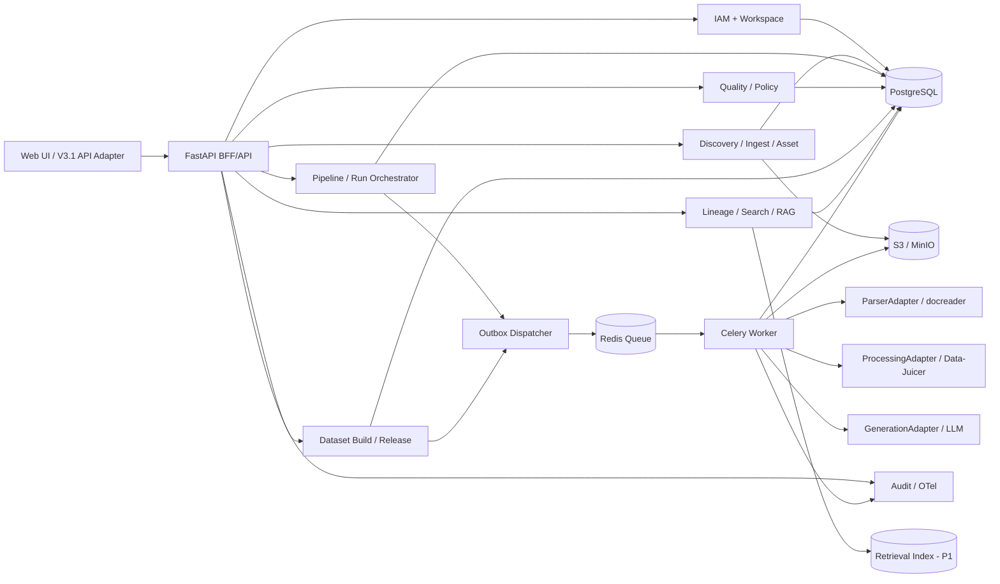
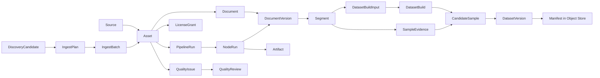
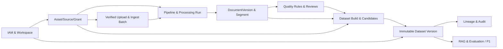

# CorpusFlow｜技术方案设计（架构、模块、数据库、API、依赖与工程规范）

> **文档编号** CF-ARCH-001　**版本** 1.0　**日期** 2026-10-23　**状态** 建议基线，待架构评审  
> **输入基线** `CorpusFlow_V3_1.html`、`CorpusFlow_V3_1_CHANGELOG.md`  
> **对应需求** `CorpusFlow_01_需求分析与确认_V1.0.md`（FR / BR / AC / NFR / TC）  
> **交付性质** 本文是**待实现的正式后端技术方案**；现有 V3.1 是离线 HTML 模拟原型，文中 API、数据库、Worker、集成均**尚未因本文而实现**。

## 0. Codex 必须遵守的实施协议

1. 进入仓库先执行：`pwd`、读取 `README`、查看目录、`git status`、识别已有依赖/测试/配置。**若已存在可用项目栈，应先出差异清单再按兼容策略实施，不得盲目覆盖项目。**
2. 将 V3.1 当作**页面与流程契约**，将《需求分析与确认》当作**业务真值**。所有授权、状态转换、发布动作在服务端实现；禁止单凭前端权限隐藏实现安全。
3. 先完成最小闭环 `权限/许可 → 上传 → Asset → Run → DocumentVersion/Segment → QA → SFT Build → Publish → Lineage`；每完成一个里程碑提交可以跑通的自动化测试。
4. 如果真实解析器、存储、LLM 不可用：明确提供 `MockAdapter` 仅供本地/CI 使用，`APP_ENV=production` **必须禁止 mock 数据被标记为真实发布**。
5. 不生成假数据、假统计冒充真实运行。所有外部副作用具有幂等性、重试、超时、告警与可审计 ID。
6. 所有 DB/API/任务状态变更必须同步维护 schema/migration/OpenAPI/测试和本文件相应 ADR；没有测试证据不得写“已完成”。

## 1. 架构决策（默认推荐，不意味着已部署）

### 1.1 推荐技术栈

| 层级 | P0 默认方案 | 选择原因 / 替换边界 |
|---|---|---|
| 现有前端 | 保留 `CorpusFlow_V3_1.html` 作为对照与演示，后续抽取 API Adapter；正式 Web **建议** TypeScript + React/Vite 或团队既有栈 | 不强制 P0 重写 UI；先让 V3.1 调真实 API 时明确“DEMO/REAL”模式 |
| 后端接口 | Python 3.12 + FastAPI + Pydantic v2 | 数据处理生态适配、OpenAPI 自动生成、结构化验证方便；若团队已有成熟后端可通过 OpenAPI 合约替换 |
| ORM 与迁移 | SQLAlchemy 2.x + Alembic；PostgreSQL 16+ | 强关系约束、事务、JSONB、索引、审计元数据；版本以最终锁文件为准 |
| 异步调度 | Redis + Celery Worker（P0）+ **PostgreSQL 持久任务状态机** | 队列是传输层，**状态真值在 PG**；人工审批不会占用活 Worker；复杂持久 DAG 后续可评估 Temporal |
| 原始文件/产物 | MinIO（本地）/ S3 兼容对象存储（生产） | 原始字节与生成产物不可变、按 SHA-256 校验、支持上传多段和签名链接 |
| 文档解析 | `ParserAdapter`：WeKnora/docreader（需锁定兼容接口/版本）+ 简单 Markdown/HTML 解析回退 | 复用成熟解析能力，但不让第三方知识库成为 CorpusFlow 的主数据模型 |
| 清洗与去重 | `ProcessingAdapter`：Data-Juicer 配方/Worker + 原生规则实现 | 配置与执行版本可追溯，先接少量选定算子，避免复制整个项目 |
| 生成服务 | `GenerationAdapter` + 可配置 LLM Provider | 生成仅为候选，不负责签发授权和最终质量判定 |
| RAG P1 | PostgreSQL FTS/pgvector 或独立索引；Rerank/LLM 可替换 | 必须执行工作空间与用途许可过滤；检索服务不是权限判定源 |
| 监控 | OpenTelemetry、结构化日志、Prometheus 指标/OTel Collector（建议） | 请求/批次/Run/Node/Build/Release 全链路关联 |
| 测试 | pytest + pytest-asyncio + httpx + Testcontainers/Compose + Playwright | API、DB、Worker 集成与页面 E2E 可验证 |
| 环境 | Docker Compose（开发/CI）→ 受控容器环境（生产） | 本轮不预设 Kubernetes 为必选 |

**ADR-001**：选择模块化单体 API + 独立 Worker，而不是 P0 就上十几个微服务。原因：模块有清晰逻辑边界、事务强、团队协作与调试成本更可控；Worker 可单独扩容。  
**ADR-002**：许可审查与数据发布**必须是平台自己的权威服务**；WeKnora / Data-Juicer 是可替换处理适配器。  
**ADR-003**：Data-Juicer 和 docreader 不能直接视为有稳定公开 HTTP API；需先调研锁定的 commit/tag、proto/CLI/输入输出格式，构建自家适配器并做契约测试。  
**ADR-004**：异步 Job 状态、节点执行和人工复核状态持久化在 PG；Redis 丢消息也能靠 Outbox/重投补偿，不能以 Redis/Celery result backend 为最终业务真值。  
**ADR-005**：数据集版本采用“**先物化不可变内容对象，再数据库事务提交 Manifest 引用，Outbox 触发后续交付**”的发布协议，避免部分发布。

### 1.2 总体逻辑架构



**控制面与数据面分离**：API 管理对象/规则/快照，Worker 处理文件字节/节点执行，大对象存储在 S3，DB 只存引用、元数据与小型 JSON。禁止在 API 请求线程里同步跑大文件 OCR 或大规模生成。

## 2. 模块结构、职责与代码组织

### 2.1 逻辑模块和不变量

| 模块 | 职责与对象 | 暴露端口/依赖 | 不允许做的事 |
|---|---|---|---|
| `identity` | OIDC/会话、workspace membership、RBAC、审计 actor | `authorize(user,action,resource)` | 仅通过前端角色字符串鉴权 |
| `discovery` | 候选、URL/DOI、IngestPlan | Candidate/Plan Repo，采集适配器 | 未获取文件就增加资产数 |
| `ingestion` | 上传会话、sha/病毒扫描、批次/失败报告 | BlobStore、Asset Repo | 信任用户填的 SHA 或只写 metadata 假装上传 |
| `catalog` | Source、Asset、Document、Version、Section/Segment、元数据/标签 | PG、检索 | 将 Source ID 与 Asset ID 复用同一语义 |
| `authorization` | grant/evidence/purpose/有效期决策、撤权传播 | PolicyDecisionService | 仅用 `authorized: true` 或“内部研究”决定训练 |
| `pipeline` | 模板 DAG 版本、Operator Registry、ProcessingBatch、Run/NodeRun、重试恢复 | Registry / Queue / Artifact | 用 Worker 成功响应代替落库、恢复驳回任务 |
| `quality` | 规则版本、自动检测、Issue/Review、人工校验、闭环 | Document/Segment/Run | 审核通过就直接写成功产物 |
| `dataset` | 用途选数/排除、Build 快照、候选/审核、拆分、门控、Release | Catalog/Policy/Quality/ObjectStore | 候选变化后沿用旧门控、允许自审自发 |
| `lineage` | 有向血缘查询、反向影响分析 | DAG Edge Repo | 凭文件名拼假血缘或跨空间泄露 |
| `verification` | RAG query、检索快照、引用证据、反馈 Issue | Policy + Index + LLM | 无命中仍造答案、引用上次查询结果 |
| `integrations` | docreader / Data-Juicer / LLM / 外部源适配器、状态探测 | ports/adapters | 让外部系统成为平台唯一状态源 |
| `observability` | 业务事件审计、请求 tracing、指标、脱敏日志 | outbox/OTel | 在日志/审计写秘钥或敏感全文 |

### 2.2 建议仓库目录（按模块单体组织）

```text
corpusflow/
├── README.md
├── docs/
│   ├── specs/                    # 本两份文档；规范和追踪矩阵
│   ├── adr/                      # ADR-001…、变更决策
│   └── api/                      # 版本化 openapi.yaml、示例
├── apps/
│   ├── web/                      # UI（保留 V3.1 原型副本作为 fixture）
│   └── api/
│       ├── pyproject.toml
│       ├── alembic/              # 不可省略的 schema migration
│       └── src/corpusflow/
│           ├── main.py           # FastAPI bootstrap
│           ├── core/             # config/security/errors/ids/time/otel
│           ├── api/v1/           # routers + DTO only
│           ├── modules/
│           │   ├── identity/
│           │   ├── discovery/
│           │   ├── ingestion/
│           │   ├── catalog/
│           │   ├── authorization/
│           │   ├── pipeline/
│           │   ├── quality/
│           │   ├── dataset/
│           │   ├── lineage/
│           │   └── verification/
│           ├── adapters/
│           │   ├── storage/s3.py
│           │   ├── parser/docreader.py
│           │   ├── processing/data_juicer.py
│           │   ├── generation/llm.py
│           │   └── search/retriever.py
│           ├── db/               # session, base, migrations helpers
│           └── worker/           # tasks + dispatchers + scheduling
├── tests/
│   ├── unit/                    # policy / state machine / build
│   ├── integration/             # PG / Redis / S3 / Worker
│   ├── contract/                # OpenAPI/adapter/schema
│   ├── e2e/                     # Playwright API-connected
│   └── fixtures/                # FX-01..08，合法/非法样本
├── infra/
│   ├── compose.yaml
│   ├── docker/
│   └── configs/                  # 无真实 secret
└── .github/workflows/ci.yml
```

**分层规则**：`router → application service → domain policy → repository/adapter`；业务决策不得写到页面渲染函数、ORM event 里或 Celery task 的零散 if 判断中。Router 仅做身份/DTO/状态码；Service 持有事务边界；Adapter 实现外部协议；Policy 实现纯函数规则，可单元测试。

## 3. 核心状态机与操作事务

### 3.1 必须区分的状态

| 对象 | 状态示例 | 合法方向及关键不变量 |
|---|---|---|
| UploadSession | `initiated → uploading → uploaded → verified → registered`，或 `failed` | 只有 verified 且完成登记才生成 Asset；客户端选择不入库 |
| IngestPlan | `candidate → approved → fetching → acquired|failed|cancelled` | `acquired` 后仍需验证字节和入库才有 Asset |
| PipelineRun | `queued → running → succeeded`；`running → failed|awaiting_review|cancelled`；`awaiting_review → ready_to_resume → queued` | 审核驳回无法转 ready_to_resume，成功需产物与检查 |
| NodeRun | `pending → running → succeeded|failed|skipped`，失败可新建 attempt | attempt 不覆盖旧日志，重试幂等 |
| QualityIssue | `open → in_review → approved_for_rework|rejected|returned|isolated → resolved` | `approved_for_rework` 不等于 resolved；rejected/isolated 不可 resume |
| DatasetBuild | `draft → selecting → snapshot_locked → generating → awaiting_review → validated → published`；任一步可 `failed|invalidated|cancelled` | input/config 变更后 invalidated，重新构建 |
| DatasetVersion | `staging → published → deprecated|revoked` | published 的内容/manifest 不变，撤权只能更改可用性/公告 |
| LicenseGrant | `pending → confirmed → expired|revoked` | confirmed 必须含 purpose、证据、有效区间与责任人 |

所有状态变化**通过一个后端 transition service** 执行，传入 `expected_revision` 防并发双写。每条 transition 写 Event + Audit + Outbox（必要时）同事务提交，非法转换返回 409 `INVALID_STATE_TRANSITION`。

### 3.2 批量 N 个 Asset 处理

1. POST Batch 请求检查每个 ID 的 workspace/存在性/格式/合法性/运行策略；逐项返回 `accepted` 或 `rejected(reason)`，**不静默丢弃部分对象**。
2. 同一事务创建 ProcessingBatch、N 个合法 PipelineRun、绑定 `asset_id`、`pipeline_version_id`、`config_snapshot_hash`，写 Outbox 事件。
3. Dispatcher 发送消息 `RunQueued(run_id)`；Worker 读取 DB 决策当前节点，在事务中占有/续租任务；调用适配器后写新 NodeRun/Artifact/Log 等；每项独立失败/重试。
4. Batch 状态由所有子 Run 聚合计算：`queued|running|partial_success|succeeded|failed|cancelled`；不能把批次标完成导致单 Run 丢失。
5. `Idempotency-Key` + actor + route + body_hash 作用域内重放相同结果；同 key 不同 body → 409。

### 3.3 审核与恢复（关键缺陷保护）

```text
NodeRun failed → QualityIssue open → reviewer decision
    ├─ rejected / isolated / returned → Run blocked, resume 409
    └─ approved_for_rework → Run ready_to_resume
                                  ↓ explicit resume by engineer
                               queued → Worker executes failed node
                                  ├─ failed → new attempt / issue remains
                                  └─ success + quality recheck
                                         ↓ new immutable Artifact / DV / Segment
                                       Issue resolved, Run succeeded
```

审查员不能直接调用 Worker 产物写入接口；Worker 不能修改历史成功版本的内容。恢复时按 `issue_id + issue_revision + run_id` 乐观锁校验，驳回后旧的审核批准令牌失效。

### 3.4 构建与不可变发布协议

1. **Preview** 只执行评估，返回 `included/excluded + reasons + source_groups + tokenizer_version`；不隐式发布。
2. **Lock Build** 保存 canonical JSON config + deterministic ordered input segments（segment_id, dv_id, content_hash, source_id, license_decision_version）并求 `SHA-256`；版本化策略/LLM/Prompt 记录在构建中。
3. **Generate** 生成候选（可异步），逐样本建立 evidence；**Review** 以人类 user_id 和 review revision 记录不可变审批事件。
4. **Validate Release Candidate**：拿到精确批准样本集合 + 当前有效许可 + 最新阻断异常 + Schema/血缘/重复/分组检查，对该集合生成报告与 `release_candidate_hash`。源授权若撤销，应直接阻断新发布。
5. **Stage Artifacts**：生成不可变 JSONL/Parquet（P0 可优先 JSONL），到对象存储临时 key；校验大小、SHA-256 与 manifest 样本 ID；失败保留可回收临时对象且不建 Published Version。
6. **Commit**：PG 事务中验证 `expected_build_revision`、审批身份分离、版本号唯一、哈希一致，创建 `dataset_version`, `version_samples`, `manifest` 引用并置 `published`，写审计 + Outbox。
7. **Finalize**：出站事件通知检索/导出，后台清理 staging 垃圾；重复 publish_request_id 返回原 Version；历史对象、Manifest 原样保留。

**注意**：如 S3 写入成功但 PG 事务失败，必须通过清理/补偿机制删除 staging，而不是留下可见的“半发布版本”。发布需要明确规则来处理已发布版本的**后续**许可证撤销（阻断下载/训练、标记 revoked 或处置，不修改历史 Manifest）。

## 4. 数据库设计（PostgreSQL）

### 4.1 共同字段与约束规范

所有业务表默认有：`id`（UUID/ULID；对外不暴露可预测自增）、`workspace_id`（必要时）、`created_at timestamptz`、`updated_at`、`created_by`、`revision bigint default 1`；软删除表使用 `deleted_at`。除 DB 生成 ID/时间外，**不允许客户端设置**。枚举与检查约束明确；外键开启；`workspace_id` 参与复合唯一/过滤索引；所有写操作必须在指定 workspace 上授权。

原始大文本/文件存对象存储；SQL 存短文本/抽样预览和 `object_key, checksum`。Source、Asset、DocumentVersion、Segment、Sample、DatasetVersion 均有不可复用稳定 ID；**Asset 的 content_sha256 与 DatasetVersion 内容 hash 使用真正 SHA-256**，不能使用 `DEMO-*` 签名代替。

### 4.2 关系模型（按域分组）

| 表名 | 关键列（除共通列） | 唯一/索引/关系 |
|---|---|---|
| `workspaces` | name, status, settings_json | unique(slug) |
| `users` | oidc_sub, display_name, disabled_at | unique(issuer, oidc_sub) |
| `workspace_memberships` | user_id, workspace_id, role, status | unique(workspace_id,user_id,role) |
| `sources` | name, kind, url, owner_id, provenance | index(workspace_id, name) |
| `discovery_candidates` | source_id?, title, url, doi, state, plan_id? | index(workspace_id,state), URL normalize+dedup |
| `ingest_plans` | status, query_snapshot, planned_count, approved_by | only metadata, no asset implied |
| `ingest_plan_items` | plan_id, candidate_id, fetch_state, error_code | unique(plan_id,candidate_id) |
| `upload_sessions` | filename, declared_size, content_type, status, checksum?, expires_at | index(workspace_id,status), expiring cleanup |
| `ingest_batches` | owner_id, ingest_type, status, totals_json, created_at | index(workspace_id,created_at desc) |
| `ingest_batch_items` | batch_id, upload_session_id, asset_id?, status, error_code | unique(batch_id,upload_session_id) |
| `asset_blobs` | storage_key, sha256, byte_size, media_type, scan_status, immutable | unique(storage_scope,sha256) if policy allows dedup |
| `assets` | source_id, blob_id, category, format, title, language, metadata_json, ingestion_status, quality_status | index(workspace_id,category,format), index(source_id), blob FK |
| `asset_domains` | asset_id, taxonomy_term_id | unique(asset_id,taxonomy_term_id) |
| `taxonomy_terms` | parent_id?, code, name, version | unique(version,code) |
| `license_evidence` | source_id?, asset_id?, uri, legal_basis, reviewed_by, reviewed_at, evidence_sha256 | evidence append-only |
| `license_grants` | asset_id, purpose, status, valid_from, valid_until, evidence_id, policy_revision, decision_reason | index(asset_id,purpose,status), revocation event |
| `documents` | asset_id, canonical_title, latest_version_id?, parse_status | FK asset, index(asset_id) |
| `document_versions` | document_id, version_no, parser_name, parser_version, config_hash, run_id, artifact_id, sha256, status | unique(document_id,version_no), **immutable on success** |
| `document_sections` | document_version_id, parent_section_id?, heading, order_no, page_start/end, bbox_json | index(dv_id,order_no) |
| `segments` | document_version_id, section_id, type, page_start/end, text_ref, text_hash, token_count, quality_state, evidence_loc_json | index(dv_id, quality_state), FTS optional |
| `segment_domains` | segment_id, taxonomy_term_id | unique(segment_id,taxonomy_term_id) |
| `pipeline_templates` | name, type, active_version_id | unique(workspace_id,name) |
| `pipeline_versions` | template_id, semver, dag_json, dag_hash, status, published_by | unique(template_id,semver); immutable after activation |
| `operator_definitions` | operator_key, adapter_kind, version, input_schema, output_schema, params_schema | unique(operator_key,version) |
| `processing_batches` | pipeline_version_id?, total, status, idempotency_key | index(workspace_id,status) |
| `pipeline_runs` | batch_id?, asset_id, pipeline_version_id, config_snapshot_json, snapshot_hash, status, current_node_id, attempt, error_code | index(workspace_id,status,created_at), index(batch_id,asset_id) |
| `node_runs` | run_id, node_id, attempt_no, operator_version, input_artifact_id?, output_artifact_id?, metrics_json, log_ref, status, error_code, timing | unique(run_id,node_id,attempt_no) |
| `artifacts` | kind, storage_key, content_sha256, producer_run_id/node_run_id, byte_size, media_type | immutable if final, index(run_id) |
| `quality_rules` | rule_key, version, dimension, params_schema, threshold_json, severity | unique(rule_key,version) |
| `quality_results` | rule_id, target_type/id, run_id, metrics_json, passed, calculation_version | index(target_type,target_id), rule version pinned |
| `quality_issues` | asset_id, doc_version_id?, segment_id?, run_id?, rule_id?, status, severity, reason, evidence_ref | index(workspace_id,status), revision lock |
| `quality_reviews` | issue_id, reviewer_id, decision, note, evidence_refs, previous/new_status | append only, index(issue_id,created_at) |
| `dataset_definitions` | name, product_type, owner_id, description | unique(workspace_id,name) |
| `dataset_builds` | dataset_id, product_type, config_json, config_hash, selection_hash, inputs_hash, status, source_groups_json, strategy_version, model_version, prompt_version, revision | index(dataset_id,created_at), immutable lock fields |
| `dataset_build_inputs` | build_id, segment_id, document_version_id, content_sha256, source_id, license_decision_ref | unique(build_id,segment_id) |
| `candidate_samples` | build_id, sample_key, payload_json/ref, payload_hash, source_id, schema_version, status, quality_json | unique(build_id,sample_key), immutable payload after review |
| `sample_evidence` | candidate_sample_id, segment_id, quote_hash?, role, relation | unique(candidate_sample_id,segment_id,role) |
| `sample_reviews` | candidate_sample_id, reviewer_id, decision, note, sample_hash, revision | append only; reject stale sample_hash |
| `dataset_versions` | dataset_id, build_id, version, manifest_key, manifest_sha256, content_sha256, sample_count, tokens, status, published_by | unique(dataset_id,version), published immutable |
| `dataset_version_samples` | dataset_version_id, candidate_sample_id, split, sample_hash, order_no | unique(version_id,sample_id) |
| `lineage_edges` | from_type/id, to_type/id, relation, run_id?, build_id? | index(from...), index(to...), workspace scope |
| `rag_queries` | query_text_hash, query_text_ref?, index_version, run_config, user_id, status | query_id stable |
| `rag_hits` | query_id, segment_id, rank, score, cited, retrieval_snapshot_json | unique(query_id,rank) |
| `rag_feedback` | query_id, hit_id?, issue_id?, feedback_type, author_id | index(query_id) |
| `audit_events` | actor_id, workspace_id, action, resource_type/id, request_id, before_after_summary, timestamp | append only, partition by time if needed |
| `outbox_events` | aggregate_type/id, event_type, payload_json, status, retry_count, next_attempt_at | index(status,next_attempt_at), event UUID |
| `idempotency_keys` | actor_id, workspace_id, route, key_hash, request_hash, response_ref, expires_at | unique(actor_id,workspace_id,route,key_hash) |

**架构约束**：`DatasetVersion` 与 `CandidateSample` 的外键不可使用 `ON DELETE CASCADE` 导致历史发布消失；保留审计/合法留存策略。质量/授权决定还须校验资产所属 workspace 与源文件实际证据。

### 4.3 关键 DDL 样例（生产时由 Alembic 迁移生成）

```sql
-- 用途不隐式继承；许可必须具备证据。
CREATE TYPE corpus_purpose AS ENUM
 ('research', 'training', 'rag', 'evaluation', 'redistribute');
CREATE TYPE grant_status AS ENUM
 ('pending', 'confirmed', 'revoked', 'expired');
CREATE TABLE license_grants (
  id uuid PRIMARY KEY,
  workspace_id uuid NOT NULL REFERENCES workspaces(id),
  asset_id uuid NOT NULL REFERENCES assets(id),
  purpose corpus_purpose NOT NULL,
  status grant_status NOT NULL DEFAULT 'pending',
  evidence_id uuid REFERENCES license_evidence(id),
  valid_from timestamptz,
  valid_until timestamptz,
  policy_revision integer NOT NULL,
  created_at timestamptz NOT NULL DEFAULT now(),
  updated_at timestamptz NOT NULL DEFAULT now(),
  revision bigint NOT NULL DEFAULT 1,
  CONSTRAINT confirmed_has_evidence CHECK (status <> 'confirmed' OR evidence_id IS NOT NULL),
  CONSTRAINT positive_validity CHECK (valid_until IS NULL OR valid_from IS NULL OR valid_until > valid_from)
);
CREATE INDEX idx_license_decision ON license_grants
 (workspace_id, asset_id, purpose, status, valid_until);
-- 查询时还要防止重叠冲突 grant：由 service + 事务/排它策略校验。

CREATE TABLE pipeline_runs (
  id uuid PRIMARY KEY,
  workspace_id uuid NOT NULL REFERENCES workspaces(id),
  batch_id uuid REFERENCES processing_batches(id),
  asset_id uuid NOT NULL REFERENCES assets(id),
  pipeline_version_id uuid NOT NULL REFERENCES pipeline_versions(id),
  config_snapshot jsonb NOT NULL,
  snapshot_hash char(64) NOT NULL,
  status text NOT NULL CHECK(status IN ('queued','running','awaiting_review',
               'ready_to_resume','failed','succeeded','cancelled')),
  revision bigint NOT NULL DEFAULT 1,
  created_at timestamptz NOT NULL DEFAULT now(),
  updated_at timestamptz NOT NULL DEFAULT now()
);
CREATE INDEX idx_run_batch ON pipeline_runs (batch_id, asset_id);

CREATE TABLE dataset_versions (
  id uuid PRIMARY KEY,
  workspace_id uuid NOT NULL REFERENCES workspaces(id),
  dataset_id uuid NOT NULL REFERENCES dataset_definitions(id),
  build_id uuid NOT NULL REFERENCES dataset_builds(id),
  version text NOT NULL,
  manifest_key text NOT NULL,
  manifest_sha256 char(64) NOT NULL,
  content_sha256 char(64) NOT NULL,
  status text NOT NULL CHECK(status IN ('staging','published','deprecated','revoked')),
  published_by uuid REFERENCES users(id),
  created_at timestamptz NOT NULL DEFAULT now(),
  UNIQUE(dataset_id,version)
);
-- 服务层/数据库 trigger 阻止 published 版本内容列 UPDATE；
-- revoke 只改变分发状态，不修改 Manifest 与历史文件。
```

**重要**：该 SQL 片段只作为结构约束示例；依赖表的完整迁移按上文建表顺序实现，并测试外键和回滚。实施时需决定 UUID v7/ULID、类型命名与分区策略，避免不兼容修改。

### 4.4 主数据关系简图



## 5. API 契约设计（`/api/v1`，建议 REST + OpenAPI 3.1）

### 5.1 统一 API 规范

- API 默认 JSON UTF-8；文件字节走预签名上传或 chunk endpoint，不进入普通 JSON 请求。
- 统一路径 `/api/v1/...`；单数 ID 用 `/{resource_id}`；列表支持 `limit(默认20,最大100)`, `cursor`, `sort` 以及白名单过滤。
- 读操作 `GET` 幂等；写入关键接口要求 `Idempotency-Key`；状态迁移还要求 `If-Match` / `expected_revision`。对外返回 `request_id`、`trace_id`（可选）。
- 标准错误：`400 INVALID_ARGUMENT`、`401 UNAUTHENTICATED`、`403 PERMISSION_DENIED`、`404 NOT_FOUND`、`409 CONFLICT|INVALID_STATE_TRANSITION|STALE_BUILD|SELF_APPROVAL_FORBIDDEN`、`412 PRECONDITION_FAILED`、`422 VALIDATION_FAILED`、`429 RATE_LIMITED`、`503 ADAPTER_UNAVAILABLE`；错误响应不含堆栈或敏感信息。
- `202 Accepted` 表示异步任务**已接收并持久化**，不代表任务成功；返回 `run_id/job_id` 和查询 URL。
- **用途策略 API** 内部与外部都不得仅依赖前端 `eligible=true`；发布前必须重新调用 authoritative policy service。
- 以 `workspace_id` 从会话权限上下文推导；请求体携带 workspace_id 时服务端验证成员关系，不信任前端传值。

**分页响应**：

```json
{"items": [], "page": {"next_cursor": null, "limit": 20},
 "total_count": 0, "as_of": "2026-10-23T00:00:00Z",
 "request_id": "req_example"}
```

**错误响应**：

```json
{"error": {"code": "AUTH_PURPOSE_DENIED",
 "message": "该来源未获得 training 用途授权",
 "details": [{"asset_id": "ast-example", "purpose": "training", "reason": "grant_missing"}],
 "retryable": false}, "request_id": "req_example"}
```

### 5.2 P0 API 清单与依赖

| 方法 + 路径 | 功能 / 典型请求 | 权限 | 前置依赖 | 主要响应 |
|---|---|---|---|---|
| `POST /auth/session` / `GET /auth/me` | OIDC 会话交换或开发环境登录、当前身份/空间 | 匿名/登录 | IAM | token/session、roles、workspace |
| `GET /workspaces` / `POST /workspaces/{id}/members` | 空间查询/成员管理 | read / admin | IAM + PG | workspace/member |
| `POST /discovery-candidates` | 建候选（不建 Asset） | ingest | Source | candidate_id |
| `POST /ingest-plans` / `GET /ingest-plans/{id}` | 计划候选获取 | ingest/read | Discovery | plan_id, status |
| `POST /uploads/init` | 文件名/大小/类型/声明 SHA（可选） | ingest | IAM + S3 | upload_id, part URLs |
| `POST /uploads/{id}/complete` | 完成分片并请求校验 | ingest | S3 + hash/AV | upload_status + job_id |
| `POST /ingest-batches` / `GET /ingest-batches/{id}` | 绑定已校验上传登记资产 | ingest/read | Verified Blob + Source | batch + items/assets |
| `GET /assets` / `GET /assets/stats` | 查询资产/统计，筛选同口径 | read | PG + AuthZ | paginated assets / metrics |
| `GET /assets/{id}` / `GET /assets/{id}/content-url` | 文件详情/预签名读 | read + object level | S3 + Grant | asset / expiring URL |
| `PATCH /assets/{id}/metadata` | 修改非原始字节元数据，需版本号 | ingest | PG + audit | asset revision |
| `POST /authorization/decisions` | `{asset_ids, purpose, action}` 按用途判定 | read/process/publish 视 action | Grant/evidence | per-asset allow/deny/reason/policy_version |
| `POST /pipeline-runs/batches` | 多 Asset + PipelineVersion + 参数 | process | Asset+Pipeline+Queue | processing_batch + accepted/rejected + run IDs |
| `GET /pipelines` / `POST /pipelines` | 列表/创建模板（按版本） | read/process | Registry | pipeline definition |
| `POST /pipelines/{id}/versions` | 保存并校验新 DAG 版本 | process | DAG validator | version_id / hash |
| `GET /pipeline-runs/{id}` / `/nodes` / `/logs` | Run、NodeRun、日志与指标 | read | PG/ObjectStore | status/metrics |
| `POST /pipeline-runs/{id}/resume` | 恢复，要求 issue review token 与 revision | process | QA + StateMachine | 202 / 409 blocked |
| `GET /documents` / `GET /documents/{id}/versions` | 文档/解析历史 | read | Catalog | document/DV |
| `GET /segments` / `GET /segments/{id}` | 结构化片段搜索与详情 | read | Catalog + policy | segments |
| `POST /quality/issues/{id}/reviews` | 审核（approve/return/reject/isolate） | review | QA + audit | event / new issue state |
| `GET /quality/reports` / `GET /quality/issues` | 质量与审核统计 | read | QA | reports + issues |
| `POST /datasets` / `GET /datasets` | 数据集定义/目录 | process/read | IAM | dataset_id |
| `POST /dataset-builds/preview` | 不提交的用途级选数 + 排除原因 | process | Segment+Policy+QA | included/excluded counts |
| `POST /dataset-builds` | 锁选数与 config snapshot，入队生成 | process | Build+ObjectStore+Queue | build_id, hash, status |
| `GET /dataset-builds/{id}` / `/candidates` | 构建/候选/质检查看 | read | Build | snapshot, samples |
| `POST /candidate-samples/{id}/reviews` | 候选批准/驳回 | review | Sample+audit | review event |
| `POST /dataset-builds/{id}/validate` | 生成发布候选门控报告 | publish/read(预览) | Policy+QA+Lineage | checks, release_candidate_hash |
| `POST /datasets/{id}/versions` | 不可变发布，需 build/revision/manifest | publish | Store+Transaction+Audit | dataset_version_id/manifest_sha256 |
| `GET /datasets/{id}/versions/{version_id}` | 版本、签名、血缘 | read | DB + ObjectStore | manifest, metrics |
| `GET /lineage/{object_type}/{object_id}` | 前后向血缘及节点详情 | read | Lineage + policy | nodes, edges |
| `GET /audit-events` | 按资源/操作者/时间检索 | admin/受控审计角色 | Audit | immutable event summary |
| `GET /health/live` / `/health/ready` | 心跳/依赖探测 | 运维 | Postgres/Redis/S3 | readiness |

**注意**：`POST /dataset-builds/validate` 可允许工程师“预览检查”，但**任何用于发布的最终校验必须在发布端点再次由服务端运行**；不可把客户端保存的 `checks.ok=true` 当通行证。

### 5.3 API 请求/响应示例

**批量处理提交**：

```http
POST /api/v1/pipeline-runs/batches
Authorization: Bearer <access-token>
Idempotency-Key: batch-example-001
Content-Type: application/json
```

```json
{"pipeline_version_id":"pv-pdf-1",
 "asset_ids":["ast-A","ast-B","ast-C"],
 "config_overrides":{"ocr_enabled":true},
 "execution_policy":{"max_attempts":3,"fail_fast":false}}
```

```json
{"processing_batch_id":"pb-example","status":"queued",
 "accepted":[{"asset_id":"ast-A","run_id":"run-A"},{"asset_id":"ast-B","run_id":"run-B"}],
 "rejected":[{"asset_id":"ast-C","code":"ASSET_NOT_READY","reason":"解析前置校验未通过"}],
 "accepted_count":2,"rejected_count":1,"request_id":"req-example"}
```

**授权决策**：

```json
{"purpose":"training","action":"dataset_build",
 "asset_ids":["ast-A","ast-B"]}
```

```json
{"policy_version":"policy-2026-10-23",
 "decisions":[{"asset_id":"ast-A","allowed":true,"grant_ids":["grant-1"]},
 {"asset_id":"ast-B","allowed":false,"reason_codes":["RESEARCH_ONLY"]}]}
```

**SFT 构建请求**：

```http
POST /api/v1/dataset-builds
Idempotency-Key: build-example-001
```

```json
{"dataset_id":"dataset-example","product_type":"SFT",
 "selection":{"domain_codes":["cryptanalysis"],"source_types":[],
 "quality":"reviewed","selected_segment_ids":["seg-1","seg-2"]},
 "strategy":{"questions_per_segment":2,"require_evidence":true,
 "human_review_required":true,"model_ref":"model-registered-id",
 "prompt_template_version":"sft-prompt-v1"},
 "split":{"train_pct":80,"validation_pct":10,"test_pct":10,
 "group_by":"source_id","seed":20261023}}
```

**构建创建响应**：

```json
{"build_id":"build-example","status":"queued",
 "config_hash":"64hexsha256...","input_snapshot_hash":"64hexsha256...",
 "locked_inputs_count":2,"status_url":"/api/v1/dataset-builds/build-example"}
```

**版本发布请求（示意）**：

```json
{"build_id":"build-example","expected_build_revision":6,
 "release_candidate_hash":"64hex...",
 "version":"v1.0.0","publish_request_id":"publish-example-001"}
```

成功 `201 Created` 返回 `dataset_version_id`、`manifest_sha256`、`content_sha256`、`published_at`；`409 STALE_BUILD` 不创建版本。**API 示例中的伪 ID/哈希只描述形状，不是真实部署返回值。**

### 5.4 错误码（稳定契约，不随中文文案变化）

| code | HTTP | 触发条件 | 可重试 |
|---|---:|---|---|
| `AUTH_PURPOSE_DENIED` | 403/422* | 数据未获目标用途许可 | 否 |
| `PERMISSION_DENIED` | 403 | 操作者无权或对象级越权 | 否 |
| `SELF_APPROVAL_FORBIDDEN` | 409 | 发布人与审核人相同 | 否 |
| `ASSET_NOT_READY` | 422 | 原始字节未校验/登记 | 视修复情况 |
| `DUPLICATE_CONTENT` | 409 | 按策略拒绝重复文件 | 否 |
| `INVALID_PIPELINE_DAG` | 422 | 有环/格式不匹配/未知算子 | 否 |
| `RUN_REVIEW_BLOCKED` | 409 | issue 未批准重处理/已驳回 | 否 |
| `INVALID_STATE_TRANSITION` | 409 | 非法状态转换 | 否 |
| `STALE_BUILD` | 409 | 输入/配置/候选/审查快照变化 | 否（重建） |
| `RELEASE_GATE_FAILED` | 422 | 许可/质量/schema/拆分门控失败 | 否（整改后重验） |
| `VERSION_CONFLICT` | 409 | 已存在相同 dataset/version | 否 |
| `ADAPTER_UNAVAILABLE` | 503 | 解析器/模型/清洗器不可用 | 是（带 backoff） |
| `EXTERNAL_SOURCE_BLOCKED` | 422 | URL SSRF/策略不允许 | 否 |

`*` **统一规定**：如果是当前请求操作者**无权操作**，返回 403；如果其有权构建但某份数据**不具备该用途 grant**，在选数预览中返回 `excluded(reason)`，在正式提交中返回 422 `AUTH_PURPOSE_DENIED`。避免用 403 泄露别的工作空间资源存在性。

## 6. 对外依赖与接口适配方案

### 6.1 接口抽象（后端应用层只依赖这些 Ports）

```python
from typing import Protocol

class BlobStore(Protocol):
    async def put_verified(self, key: str, content: bytes, sha256: str) -> str: ...
    async def get_signed_url(self, key: str, ttl_seconds: int) -> str: ...

class ParserAdapter(Protocol):
    async def parse(self, *, asset_ref: str, media_type: str,
                    config: dict, correlation_id: str) -> dict: ...

class ProcessingAdapter(Protocol):
    async def execute(self, *, operator: str, input_ref: str,
                      params: dict, run_id: str) -> dict: ...

class GenerationAdapter(Protocol):
    async def generate_candidates(self, *, segment_refs: list[str],
                                  strategy: dict, build_id: str) -> list[dict]: ...

class RetrieverAdapter(Protocol):
    async def search(self, *, query: str, filter_ids: list[str],
                     index_version: str, k: int) -> list[dict]: ...
```

上述代码是**接口草案**，不代表外部项目存在同名方法；真实类型应使用 Pydantic DTO + async IO/流式对象读取，避免大型文件全部加载到内存。

### 6.2 组件复用决策与依赖优先级

| 组件 | P0/P1 复用点 | 必须核对的真实接口 | 失败与回退 | 禁止事项 |
|---|---|---|---|---|
| **WeKnora / docreader** | P0/P1 PDF、Office、扫描件解析；页码、Markdown、表格/公式定位 | 锁定 tag/commit、gRPC proto/HTTP 版本、返回字段、图片/附件路径、超时/重试 | 无服务则 Run `failed/blocked`，可用已验证的本地 parser 子集回退并在产物写明解析器 | 不能把 WeKnora 的 KB/Chunk ID 当作自有 Segment 主键 |
| **Data-Juicer** | P1 清洗、过滤、去重、质量算子；将 recipe 与配置冻结 | 具体算子名/参数/输入 JSONL/输出格式/CLI Exit Code/执行环境 | 检查 Exit Code、stderr 与记录数；失败重试/隔离、必要时降级到本地已实现算子 | 不传未授权原文到外部托管环境；不能只看退出码不校验产物 |
| **LLM Provider** | P0 SFT 候选生成（可先测试 Mock，不视为正式） | 模型版本/Provider/参数/Token 用量、结构化 JSON 输出、预算限流 | 超时重试、样本级拒绝、人工审核；服务不可用绝不声称已生成 | 模型不能自动签发许可证或取代人工发布审批 |
| **S3/MinIO** | P0 原件、Markdown/JSON、训练 JSONL/Manifest | multipart、object versioning、SSE、签名 URL、生命周期 | 检验 SHA，删除 staging，孤儿对象清理 | 不允许返回永久公共 URL |
| **PostgreSQL** | P0 主元数据/审计/状态/血缘 | migrations, index plan, locks | 事务回滚、读写一致性、备份 | 不用本地浏览器内存作为业务状态真值 |
| **Redis/Celery** | P0 队列执行、重试、进度事件 | 消息参数只传 ID，不携带全文/密钥 | Outbox 重投、Worker lease、幂等处理 | 不把消息 ACK 当作业务成功 |
| **检索服务/WeKnora RAG** | P1 检索/重排/引用验证 | 工作空间过滤、index_version、score 归一化、片段映射 | 无证据拒答；索引失败可降级 FTS，但明确标记 | 不相信检索端自带权限替代 CorpusFlow 策略服务 |
| **OIDC/企业 IAM** | P0 登录与身份 | issuer/audience/JWKS/claim 映射 | 验证失败拒绝访问 | 不能部署演示账号角色切换为生产鉴权 |

**WeKnora 参考**：其官方架构与文档入库流程公开描述独立 docreader 解析服务、异步任务、分块与向量化管线；这是借鉴与适配范围，并**非**本项目已连接的接口。  
**Data-Juicer 参考**：官方文档列出 mapper/filter/deduplicator 等算子类别及参数/数据集级算子；具体选择须做 POC 和版本锁定。

### 6.3 集成可靠性统一规范

- 每个适配调用：`operation_id`、trace、超时、最大重试、指数 backoff + jitter、熔断/限流、输入输出版本、结构校验、日志脱敏。
- 任一输出须保存 `producer`、`adapter_version`、`model_version`、`config_hash`、`source_content_hash`、`artifact_hash`。
- 解析器版本升级先在金标集做回归：字符准确率、表格单元格定位、公式保留、页码对齐、Token 差异；不自动覆盖已有 DV。
- Data-Juicer 配方存为不可变 `PipelineVersion`/`OperatorDefinition` 配置，系统只记录可复现执行的签名和日志引用。
- 插件集成状态来自真实 health/status probe；未测试必须显示 `not_configured/unknown`，不能推断“已连接”。

## 7. 数据产品与算法输出格式规范

### 7.1 SFT Schema（P0）

```json
{"sample_id":"sft-example","schema_version":"sft-v1",
 "messages":[{"role":"user","content":"差分密码分析的基本思想是什么？"},
             {"role":"assistant","content":"研究输入差分向输出差分传播的统计规律。"}],
 "evidence_ids":["seg-example"],"source_id":"source-example",
 "document_version_id":"dv-example", "split":"train",
 "quality":{"factuality":"reviewed","evidence_ok":true},
 "generation":{"model_ref":"model-v1","prompt_version":"prompt-v1"}}
```

**Schema 校验**：role 顺序正确、内容非空、证据真实存在且属于同 workspace、来源有 training grant、来源组拆分无泄漏、review 与 sample_hash 匹配。此为样例文本，不构成专业知识事实验证。

### 7.2 其它类型独立 schema（P1）

- **Pretrain**：`sample_id,text,source_id,document_version_id,segment_ids,token_count,tokenizer_version,split`；不凭空转成问答。
- **RAG**：`chunk_id,content,source_id,document_version_id,page,bbox?,metadata,index_schema_version,embedding_ref?`；embedding 未生成时只能 `index_pending`，不能标 `index_ready`。
- **Eval**：`eval_id,question,reference_answer,evidence_ids,difficulty,metric_tags,source_group,heldout_flag`；必须检查与训练源组/近重复隔离。
- **DPO (P2)**：`prompt,chosen,rejected,preference_reason,reviewer,source_refs`，使用独立候选偏好审查；不复用 SFT Schema 假装 DPO。

### 7.3 构建配比与覆盖

- 先按 **Source Group** 分层/分组，固定 seed+算法版本，构造 Train/Validation/Test；如果源组不够，产生可解释的阻断报告。
- 记录每个产品目标/实际：`source_group_count, sample_count, token_count, document_count, domain_coverage, type_distribution, language_distribution, duplicate_rate, evidence_coverage, license_coverage`。
- 质量分数附评估规则版本、样本量、校准数据，不允许把模型自评直接作为“人工审核通过”。
- 构建清洗日志应能对照原文：`raw_text_ref → cleaned_text_ref → filtered_spans/removed_noise → operator_params`，保存变更原因。

## 8. 系统规范：安全、代码、接口、数据库、测试、运维

### 8.1 安全与数据治理

1. **认证**：生产必须使用真实 OIDC/JWT/session；服务端验证 issuer、audience、exp、签名。内部 Worker 使用服务身份，不用前端 token 代理。
2. **授权**：RBAC + 对象级工作空间隔离 + 数据用途许可，三者缺一不可；所有 GET/EXPORT/SEARCH/PUBLISH/RESUME 实施检查。
3. **上传/爬取**：安全 MIME 检测、文件大小、恶意文件扫描、ZIP 解压炸弹、URL SSRF（私有 IP、回环、重定向校验）、DOI/URL 速率限制。
4. **密钥**：通过 Secret Manager 或环境密钥引用注入，数据库只存 secret reference；日志脱敏。
5. **访问链接**：S3 使用短期预签名 URL，限制 scope/有效期；不得公布对象真实路径或长效开放桶。
6. **审计**：审批、授权变更、发布、撤权、重新运行、配置修改与导出必须审计；事件不可通过业务 UI 修改。
7. **保护**：对外响应防越权(IDOR/BOLA)、SQL 注入、存储注入、跨租户聚合泄露；审计和错误响应避免包含用户原始敏感数据。

### 8.2 编码规范

- Python 遵守 PEP8，强制 `ruff check`, `ruff format`, `pyright`/mypy（至少核心模块）、`pytest`；公共 API DTO 必须是 Pydantic v2，有清晰枚举和字段限制。
- HTTP 路由不写复杂业务 SQL；Repository 不能绕过 Service 执行状态迁移；业务规则集中于 domain 层纯函数与 PolicyService。
- 全部外部操作以可替换 adapter 包装；禁止在领域对象中引入 docreader/Data-Juicer 特定类。
- 类型/函数/包文档说明输入输出、副作用、幂等性、错误码；重大权衡写 ADR。
- 依赖精确锁定、配置由环境管理、不提交 `.env` 真值/密钥/大数据文件。
- 日志 JSON 键：`timestamp,level,service,request_id,workspace_id,actor_id,run_id,build_id,event,error_code`；敏感内容用引用与 hash 而非明文。

### 8.3 事务、并发和幂等

- DB 写入在显式事务中；关键版本/Issue/Run 使用 optimistic lock `revision`；冲突返回 409 并可重试读取。
- `idempotency_keys` 保留 TTL 并记录请求 hash/响应；重复建 batch/build/publish 不产生额外对象。
- Outbox 与业务表在同事务写入；Dispatcher at-least-once，Worker 必须幂等；每节点 `attempt_no` 单调递增。
- 发布表 `unique(dataset_id,version)`、NodeRun `unique(run_id,node_id,attempt_no)` 为**数据库硬约束**，不能只靠前端 `if`。
- 文档修订生成新 DV，历史 DV 不更新；新片段替代旧片段需 explicit supersedes 关系。
- 任务取消后不得隐藏已完成/失败节点，强制保存原因、操作者和时间。

### 8.4 API 与兼容性

- OpenAPI 文件是契约唯一事实来源；代码从契约生成类型/客户端或由 FastAPI 导出并在 CI 比较差异，二选一明确写 ADR。
- 任何新增必填字段/删除枚举/改错误码属于 breaking change，需 `/api/v2` 或迁移窗口；新增可选字段/endpoint 通常保持向后兼容。
- 各时间戳 ISO-8601 UTC，Decimal 而非 float 存储货币/高精度阈值；SHA/Token 在服务端计算。
- 客户端错误 toast 使用 `message`，逻辑判断用 `code`，不解析中文文案。

### 8.5 测试金字塔与 CI 阶段

| 层 | 必须覆盖 | 工具与证据 |
|---|---|---|
| Unit | policy 用途矩阵、state transitions、DAG 无环与 schema、split 来源隔离、build hash | pytest；参数化 TC-06/07/11/16/18 |
| DB Integration | 迁移/回滚/外键/并发/唯一/软删/空间隔离、事务发布 | Testcontainers/Compose + pytest |
| Worker Integration | N Asset→N Run、失败重试/恢复/重启、Outbox 重放、对象校验 | FakeParser + MinIO/PG/Redis |
| Adapter Contract | docreader 输入输出、Data-Juicer recipe exit/result、LLM JSON Schema、S3 multipart | 固定 fixture + 契约测试，真实集成另测 |
| API Contract | request/response/error/鉴权/idempotency、Schema 兼容 | httpx + OpenAPI 校验 |
| UI E2E | 上传→解析→结构化→审核→SFT→发布→血缘；负面路径 | Playwright 指向**真实 API 测试环境** |
| Load/Recovery | 10 万资产翻页/查询、Worker kill/restart、并发重复 publish | k6/Locust/自定义 chaos 测试，结果报告 |

**CI 阻断项**：格式/静态检查/类型/单测/迁移检查/契约/核心集成/依赖安全扫描/硬编码密钥检查。合并主干前必须由 reviewer 看权限/数据许可/审计和错误路径。

### 8.6 开发环境与配置约定

```
APP_ENV=development|test|staging|production
DATABASE_URL=postgresql+psycopg://...
REDIS_URL=redis://...
OBJECT_STORE_ENDPOINT=http://minio:9000
OBJECT_STORE_BUCKET=corpusflow-dev
PARSER_BACKEND=mock|docreader|builtin
PROCESSING_BACKEND=mock|data_juicer|native
GENERATION_BACKEND=mock|provider
RAG_BACKEND=disabled|fts|vector
AUTH_BACKEND=dev|oidc
FEATURE_ENABLE_DEMO=false
```

**生产守卫**：`APP_ENV=production` 且 `PARSER_BACKEND=mock` / `AUTH_BACKEND=dev` / `FEATURE_ENABLE_DEMO=true` 时**启动失败**；Generation mock 不得发布标记为“真实训练数据”，除非另有经过审核的离线生成策略/数据来源说明。配置更新写审计，外部依赖探活真实测量。

### 8.7 可观测与 SLO（建议值，待压测验证）

- API P95：资产标准筛选 ≤800ms（10 万记录，有合适索引），批次提交 ≤2s；Worker 吞吐/延迟分格式按 P50/P95 追踪。
- 关键指标：`ingest_bytes_total`、`pipeline_run_status_total`、`node_duration_seconds`、`quality_issue_open`、`license_denied_total{purpose}`、`dataset_gate_fail_total`、`rag_no_evidence_total`、`outbox_backlog`、`worker_retry_total`。
- 告警：队列积压、外部 parser 5xx、质量审核超时、发布失败、授权异常增长、对象存储不可达、孤儿 staging 对象过多。
- 对于 Dashboard 指标，提供 `as_of/metric_version/source`；不一致时优先 API/DB 真值而非静态卡片。

## 9. 开发实施与接口依赖顺序

### 9.1 分阶段实施（PR 粒度参考）

| 阶段 | 前置 | Codex 输出（代码/文档/测试） | 通过标准 |
|---|---|---|---|
| P0-A 工程骨架 | 无 | Compose、FastAPI、迁移、健康检查、CI/ENV、基础异常 DTO | 最小 API + PG/Redis/S3 可启动；CI 通过 |
| P0-B IAM + Policy | P0-A | Workspace/Users/Membership/License Evidence+Grant/AuthZ Policy | 用途互不推导、对象越权、自审自发单测通过 |
| P0-C Ingestion | P0-B | upload/init/complete、字节 hash、batch、Asset、去重/统计 | 上传三文件部分失败不损其它；候选不计资产 |
| P0-D Pipeline + QA | P0-C | DAG 版本、ProcessingBatch、Run/NodeRun、ParserAdapter、Artifact、Issue/Review/Resume | N=3→3 Runs；审核驳回阻断；新 DV/Segment 有血缘 |
| P0-E Dataset + Release | P0-D | selection preview、SFT Build、Candidate、Review、Gate、Manifest、Version | Build 改变阻断、许可重查、自审自发禁止、发布幂等不可变 |
| P0-F Lineage/UI 对接 | P0-E | Trace API、统计 API、真实后端 UI Adapter、E2E | Sample→Source 反查；真实 API 交互无虚假成功状态 |
| P1-A 外部适配与扩展 | P0-F | Data-Juicer/docreader POC、RAG、Eval、Parquet、报表 | 分别有金标集测试及适配器契约，不影响历史版本 |

**团队并行依赖**：IAM/Policy 在所有资源写操作之前；Asset/DV 在 Dataset 前；QA+Review 在 Resume/Publish 前；ObjectStore/Artifact 在 Pipeline 和 Release 之前；Lineage 可提前定义表与 API 但端到端验收需等待 Build 产物。

### 9.2 接口依赖图



## 10. Codex 开发任务模板（每个任务都须填写）

```markdown
### TASK-CF-XXX｜标题
- 对应需求：FR-xxx、BR-xxx、AC-xxx、TC-xxx
- 优先级/前置：P0；依赖 TASK-CF-...
- 不变式：列出不可绕过的授权、状态、哈希、审计约束
- 数据变更：表、索引、迁移、回滚、约束
- API 变更：Method/Path/DTO/错误码/OpenAPI
- Worker/外部依赖：超时、重试、幂等、Mock/Real 标记
- 验收步骤：Given/When/Then，正常路径+越权/失败/并发路径
- 测试命令：ruff / pytest / Playwright / migration check
- 交付证据：PR、测试报告、截图/Trace、接口示例
- 不在范围：明确列出本任务不做的功能
```

**单 PR 验收清单**：`[ ]` docs/ADR `[ ]` migration `[ ]` DTO/OpenAPI `[ ]` permissions `[ ]` policy `[ ]` audit `[ ]` idempotency `[ ]` error codes `[ ]` happy-path tests `[ ]` negative tests `[ ]` rollback `[ ]` UI not misleading。

## 11. 技术风险、未决策与缓解

| 风险 | 影响 | 默认缓解 |
|---|---|---|
| 授权文件不可证明训练用途 | 违规入库/发布 | 用途缺省 deny，证据台账 + 人工签发 + 撤权传播 |
| docreader/WeKnora 上游 API 变更 | 解析不可用/数据字段变化 | 锁定 tag/proto，adapter contract tests，保留基线 parser |
| Data-Juicer 配方版本漂移 | 清洗不一致 | recipe+operator+container hash 与产物绑定，重跑生成新版本 |
| 大文件/批次导致任务重复 | 重复计数、费用失控 | Outbox、Idempotency-Key、run/node 唯一键、Worker lease |
| 人工审批状态与任务运行不同步 | 驳回后继续执行 | PG 状态机 + revision 锁 + 每节点启动前质量许可检查 |
| Build 冻结后来源许可撤销 | 不合法发布 | Preview/Generate/Validate/Publish/Download 多次实时决策 |
| 数据集划分泄漏 | 评测失真 | 按来源组拆分 + hash/近重复检查 + 明确不足组阻断 |
| 并发发布/部分对象成功 | Manifest 不一致 | 先物化对象/后事务提交/Outbox/失败补偿 |
| RAG 过期证据 | 错误回答与虚假引用 | query 快照+索引版本+授权过滤、零证据拒答 |
| 前端原型与 API 字段漂移 | 交互失效 | OpenAPI 契约 + CI 的自动生成客户端/契约测试 |
| 单人“管理员”全权绕审 | 职责分离失效 | user_id 级审核/发布分离，紧急例外另有法定流程（不在 P0） |

## 12. 参考链接（技术背景，不代表已集成）

- WeKnora 官方架构：<https://github.com/Tencent/WeKnora/blob/main/website-docs/02-architecture/01-overview.md>
- WeKnora 文档入库/解析流程：<https://github.com/Tencent/WeKnora/blob/main/website-docs/02-architecture/03-document-pipeline.md>
- Data-Juicer 官方算子说明：<https://github.com/datajuicer/data-juicer/blob/main/docs/Operators.md>
- Data-Juicer 源码与配方：<https://github.com/datajuicer/data-juicer>
- OpenAPI 规范：<https://spec.openapis.org/oas/latest.html>
- OWASP API Security Top 10：<https://owasp.org/API-Security/editions/2023/en/0x11-t10/>

**最终实施准则**：先把状态、权限、授权和发布不变量做正确，再引入大规模处理与复杂模型。所有“可追溯、可复现、可信发布”必须有数据库约束、对象哈希和自动化测试证据，不能只由页面文案支撑。
